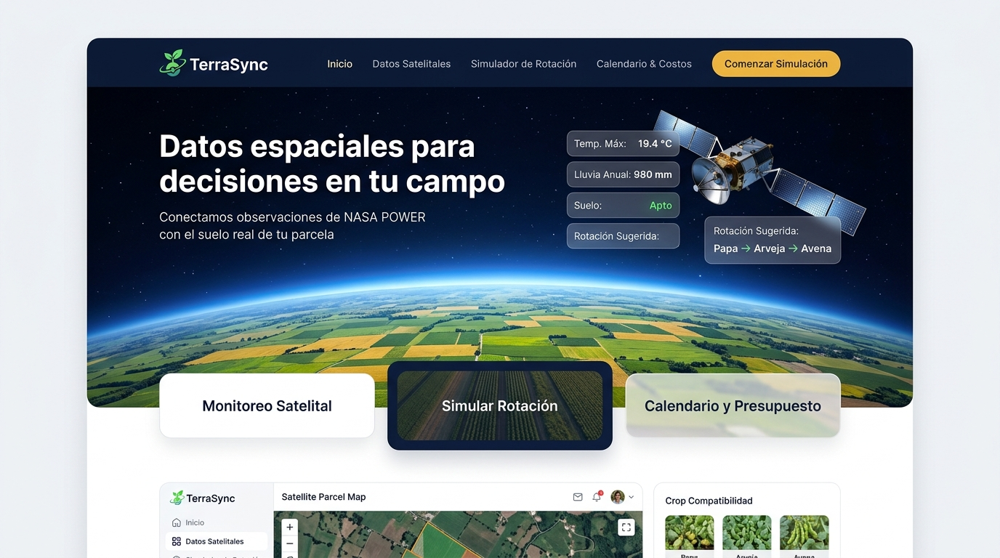
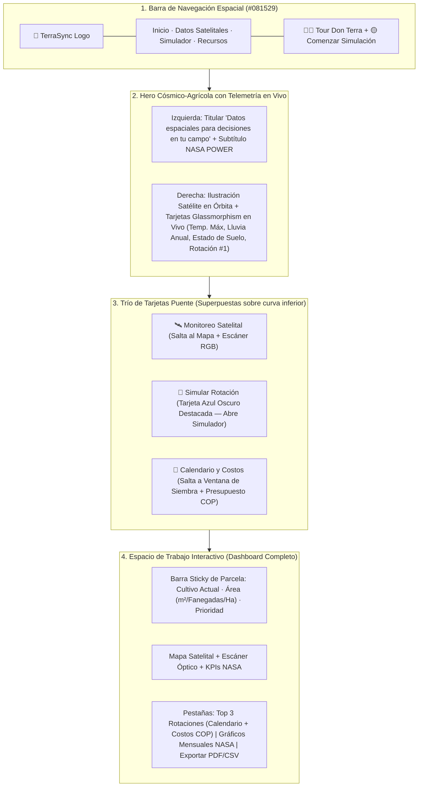

# Plan de Diseño Visual e Interfaz Aero-Agrícola: TerraSync

## 1. Visión Estética y Perspectiva Gráfica
Transformación de TerraSync en una plataforma con identidad **Aero-Agrícola ("Del Espacio a tu Parcela")**: un encabezado espacial profundo en azul cósmico con telemetría satelital en vivo (*glassmorphism*), que desciende sobre una transición curva hacia el espacio de trabajo agrícola limpio, luminoso y funcional.

---

## 2. Arquitectura Visual de la Nueva Interfaz

---

## 3. Sistema de Diseño y Paleta de Colores

| Elemento Visual | Color / Estilo | Uso en la Interfaz |
| :--- | :--- | :--- |
| **Azul Espacial Profundo** | `#071428` → `#0d2b4e` | Barra superior, fondo del Hero cósmico y tarjeta central destacada (*Simular Rotación*). |
| **Ámbar Solar (CTA)** | `#f5b041` / `#eab308` | Botón principal *"Comenzar Simulación"* e iconos de verificación en tarjetas. |
| **Azul Atmósfera / Satélite** | `#38bdf8` / `rgba(255,255,255,0.12)` | Efecto *glassmorphism* (vidrio translúcido con desenfoque) en las cápsulas de telemetría del Hero. |
| **Verde Agro (Acción)** | `#146c43` / `#198754` | Barras de compatibilidad, indicadores de lote apto, calendario óptimo y botones de exportación. |
| **Superficie Limpia** | `#f4f7f5` y `#ffffff` | Zona de trabajo inferior para garantizar máxima legibilidad bajo luz solar en campo. |

---

## 4. Detalle de Secciones

### A. Navbar Oscura Espacial (`src/layouts/Layout.astro`)
- Barra en **Azul Espacial (`#081529`)** con enlaces suaves (`Inicio`, `Datos Satelitales`, `Simulador de Rotación`, `Calendario y Costos`), acceso directo a **🧑‍🌾 Tour Don Terra** y el botón píldora dorado **`Comenzar Simulación`**.

### B. Hero Satelital con Widgets *Glassmorphism* Conectados a Datos Reales (`src/components/HeroSpace.astro`)
- **Fondo gráfico dedicado (`public/images/hero-space-agro.jpg`):** Planeta Tierra curvado con parcelas agrícolas y satélite en órbita sobre cielo estrellado.
- **Telemetría en vivo:** Las cápsulas flotantes sobre el Hero muestran en tiempo real los valores de la coordenada seleccionada en el mapa:
  - 🌡️ **Temp. Máx** (`-- °C`)
  - 🌧️ **Lluvia Anual** (`-- mm/año`)
  - 🌱 **Estado del Suelo** (`✅ Lote Apto` o `🚫 No Cultivable`)
  - 🔄 **Rotación Sugerida** (flujo ganador, ej. `Papa ➔ Arveja ➔ Avena`)

### C. Puente de 3 Tarjetas de Acceso Rápido (Transición Curva)
1. **Card Blanca Izquierda — `Monitoreo Satelital`:** Resumen del escáner óptico RGB + acceso directo al mapa satelital.
2. **Card Azul Oscuro Central — `Simular Rotación`:** Con fotografía agrícola (`public/images/card-rotacion.jpg`), resalta el flujo principal y desplaza suavemente al simulador.
3. **Card Blanca Derecha — `Calendario y Costos COP`:** Con fotografía de cultivo (`public/images/card-cultivos.jpg`), muestra el estado del mes actual y la inversión estimada del lote.

### D. Espacio de Trabajo Interactivo (`src/pages/index.astro`)
- **Mapa Leaflet Satelital** con validación de vías, edificaciones, glaciares y escáner óptico RGB.
- **Catálogo Colombiano (24 cultivos, 6 macroregiones)**, área en `m²` / `Fanegadas` / `Hectáreas` y prioridades.
- **Top 3 Tarjetas de Rotación** con calendario de 12 meses y presupuesto en `$ COP` (+18% ahorro en nitrógeno).
- **Gráficos NASA POWER**, exportación **PDF / Excel (.CSV)** y **Asistente Don Terra**.
